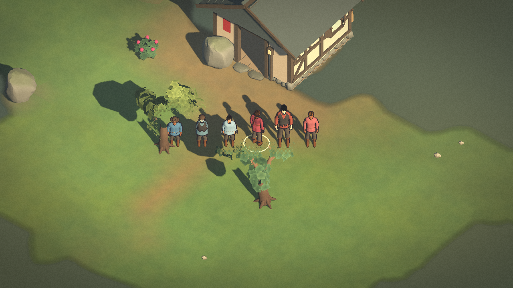
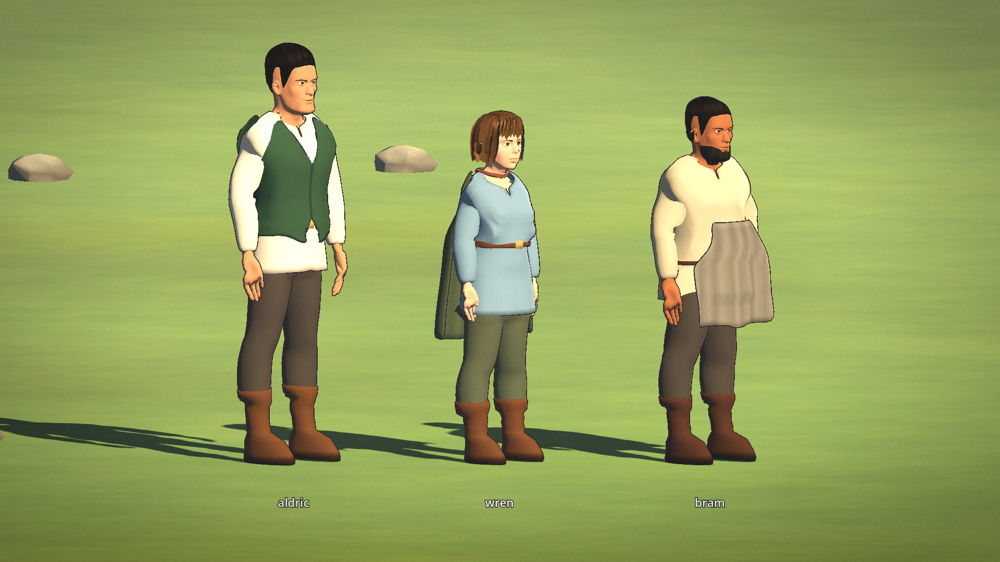

# Pass 27 — baseline before painterly reset

**Owner verdict: ITERATE. Technical evidence, not production art approval.**

Game implementation [merged #4413](https://github.com/ChrisTutorials/thistletide-gd/pull/4413); new direction [draft #4447](https://github.com/ChrisTutorials/thistletide-gd/pull/4447). Default Frontier Folk remains unchanged. MakeHuman uses `TT_KIT_PAWNS=1`.

## Original pixels

- [117-image gallery](gallery/index.html): download this directory and open index.html locally. Original PNGs are alongside it, directly obtainable through GitHub raw URLs.
- [Production baseline, r26](production-legacy-r26): 75 original PNGs, legacy pawns.
- [Matched MakeHuman, r26](production-kit-r26): 75 original PNGs; same seed/camera/source as legacy.
- [Exploratory final cloak, r27](production-kit-r27): 75 original PNGs. **Dirty exploratory capture**, not a clean matched comparison; source provenance is in scenario.json.
- [Verification and independent reviews](verification).
- [Exact runtime assets](runtime-assets), CC0 inputs recorded in GLB provenance; [generator source snapshot](generator-source).

## Limitations

These are software-rendered Godot C# captures. The review lineups and held poses are staged demonstrations, not autonomous Sim footage. Hardware lighting/frame pacing and owner aesthetic PASS are NOT RUN. Full horizontal foot planting remains unfinished. The clean 117-image pass source is 7d8b28291ff524c4f2e15956498b04d42379f702; rebased engineering and later squash merge are documented in #4413.

Review outfit silhouette first, then material distinction, dimensional lighting and painterly identity at 1×. Do not approve from test counts or portraits alone. Keep #1946/#4264/#4268/#4269 open until actual owner acceptance.
